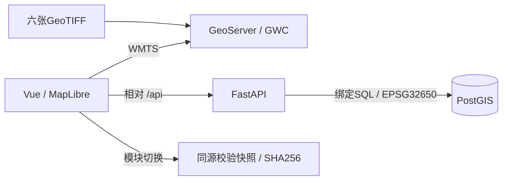

# 架构与缓存设计

地图请求直接访问GeoServer；统计请求经FastAPI到PostGIS。固定六白名单图层、标准网格和无随机参数的WMTS有利于复用缓存。分析按数据库当前代际读取，前端通过代际与请求会话拒绝晚到旧结果。完整GeoJSON用于业务，MVT独立用于瓦片工程演示。

运行拓扑是本机Compose，不是高可用集群。命名卷保存数据库及GeoServer配置，全部端口仅回环；本机密码不进入Git。镜像和依赖锁定；脚本支持UUID项目、新端口与新卷的空库重建。

未来云原生弹性设计（未部署、未验收）：静态前端通过对象存储/CDN；无状态API多副本及连接池限额；PostGIS单独管理和备份；GeoServer共享只读发布数据、GWC缓存采用可协调存储并明确失效版本；Ingress TLS、认证、NetworkPolicy、密钥托管；以p95/错误率/数据库连接和CPU驱动伸缩。先验证并发写缓存一致性与数据库瓶颈，再启用HPA。该设计说明不等于已实现挑战层。
